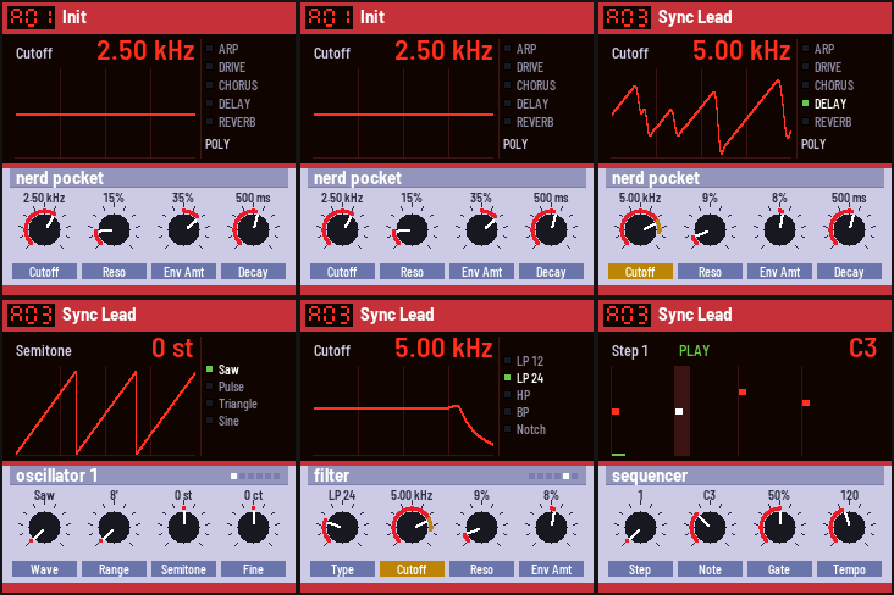

# Nerd Pocket

A virtual analog synth for the M-VAVE FM-1: two oscillators with FM, sync and ring, a multimode filter, three envelopes,
two LFOs, morph, an arpeggiator, a 16-step sequencer and effects, with 99 presets. Unofficial firmware, free to use.
The FM-1 app is open source (MPL-2.0); the synth engine is closed.

- **Try it in the browser, no FM-1 needed:** <https://jconde007.github.io/nerd-pocket/emu/>
- **Install** from Chrome or Edge, with the FM-1 connected by USB: <https://jconde007.github.io/nerd-pocket/install/>
- **Download** the package from [Releases](https://github.com/jconde007/nerd-pocket/releases).

## The synth
- **Oscillators:** osc 1 saw, pulse, triangle or sine; osc 2 saw, pulse, triangle or noise. Range 8'/4'/2', semitones and
  fine tune, pulse width, linear FM (osc 2 → osc 1), sync and ring modulation, osc 2 keyboard tracking.
- **Filter:** LP 12, LP 24, HP, BP and Notch, with resonance, envelope amount, velocity, keyboard tracking and drive.
- **Envelopes:** amp and filter ADSR, and a modulation envelope to osc 2 pitch, FM or pulse width.
- **LFOs:** LFO 1 (triangle, saw, square, random, soft random) to pitch, osc 2, filter, pulse width, FM, amp or pan;
  LFO 2 to pitch, amp or filter.
- **Voices:** 8, poly, mono or legato, unison, portamento (with Auto: it glides only when a key is already held).
- **Morph:** the mod wheel (the ALGORITHM knob) or velocity moves every knob that has a morph amount.
- **Arpeggiator:** up, down, up/down, random and echo, 1-4 octaves, synced to the tempo or free.
- **Sequencer:** 16 steps with note, gate and tempo, saved with the preset.
- **Effects:** drive, chorus, delay (free or synced) and reverb.
- **MIDI:** notes with velocity, mod wheel, pitch bend, Program Change and MIDI clock, over USB and TRS.

## Controls
| Control | What it does |
| --- | --- |
| K1-K4 | edit the four knobs of the panel on screen |
| SELECT | next panel |
| PRESETS | change program (A01-A99) |
| ALGORITHM | mod wheel |
| HOME, EDIT, ENV, LFO, FX, ARP, GLO, SEQ | open a module; press again for its next panel |
| Hold SEL + turn K1-K4 | morph amount of that knob |
| SAVE | keep the sound on this preset, with its pattern and tempo |
| Hold SEL + SAVE | back to the factory sound |
| SEQ panel | K1 step, K2 note, K3 gate, K4 tempo, SEL step on/off, PLAY start/stop, REC write steps from the keys |

## Before installing
- It uses the FM-1's second core, which is beta in felucca-bsp and misbehaves on some units. If it fails, the synth
  keeps running on one core with fewer voices until you switch it off.
- It has been tested on one FM-1. Installing is at your own risk.
- If the FM-1 runs another custom firmware the installer does not recognise, put M-VAVE's firmware back first (the
  installer's "Back to the stock firmware", or M-VAVE's M-UPGRADE), then install Nerd Pocket.
- A failed install can leave the FM-1 unable to start: felucca-bsp's `fm1_rescue` (macOS, Linux) puts the stock
  firmware back.

## Source
This repository holds the FM-1 app (`firmware/`: the screen, the controls, MIDI, the sequencer, saving) on
[fm1-base](https://github.com/charlesvestal/fm1-base) (a submodule), MPL-2.0. The code and its notes are in Spanish.
The synth engine is closed source and not included (`motor/README.md`), so the firmware does not build from this
repository alone: use the release packages or the site.

## Licence and credits
The app is MPL-2.0 (`LICENSE`). The synth engine is © 2026 Jorge Conde, closed source, free to use with this firmware.
Built on [fm1-base](https://github.com/charlesvestal/fm1-base) by Charles Vestal and
[felucca-bsp](https://github.com/hugelton/felucca-bsp), from Felucca by Leo Kuroshita, Hügelton Instruments (MPL-2.0).
The package includes three files of JieLi's AC79 SDK (Apache-2.0) and the Barlow font (SIL OFL 1.1).

M-VAVE and FM-1 are trademarks of their owners. Nerd Pocket is not affiliated with or endorsed by M-VAVE.
