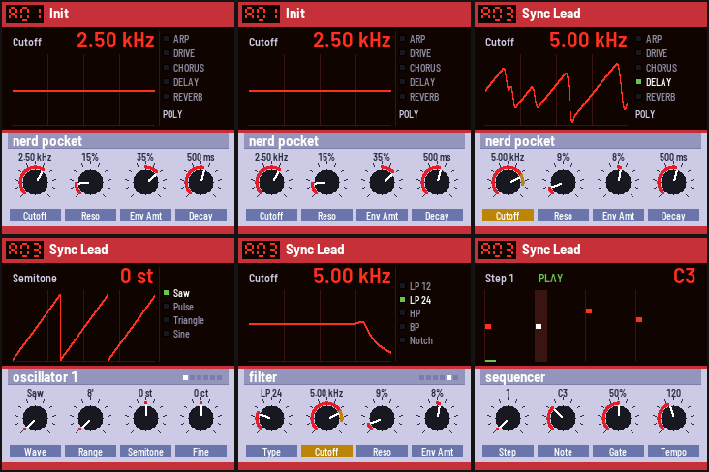

# Nerd Pocket

Nerd Pocket is a virtual analog synth for the M-VAVE FM-1: two oscillators with FM, sync and ring, a multimode filter,
three envelopes, two LFOs, morph, an arpeggiator, a 16-step sequencer and effects (drive, chorus, delay, reverb), with
99 presets and 8 voices.

Version {{VERSION}}. Unofficial firmware: installing is at your own risk, and the installer can put M-VAVE's own
firmware back. It uses the FM-1's second core, which is beta and misbehaves on some units.

- [Try it in the browser](emu/): the same code the FM-1 runs, with sound. No FM-1 needed.
- [Install](install/): from Chrome or Edge, with the FM-1 connected by USB. If it runs another custom firmware, put
  M-VAVE's back first.
- [Download {{PKG}}](firmware/{{PKG}}): for the command-line installer, `python3 tools/fm1_install.py {{PKG}}`.
- [Controls and source](https://github.com/jconde007/nerd-pocket): the FM-1 app is MPL-2.0; the synth engine is closed
  source, free to use. Built on fm1-base and felucca-bsp, from Felucca by Leo Kuroshita, Hügelton Instruments.

M-VAVE and FM-1 are trademarks of their owners. Nerd Pocket is not affiliated with M-VAVE.
